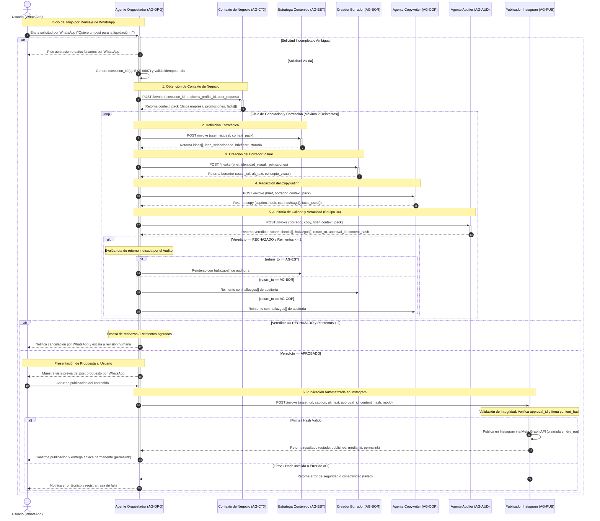

# Auditoría Técnica y Ampliación del Diagrama de Secuencia: Sistema Multiagente Retail Content Factory

El presente documento ofrece una revisión exhaustiva y una ampliación técnica del diagrama de secuencia definido inicialmente en `project_general_overview.md` para el flujo de trabajo del **Equipo 04 (Agente Auditor)**. La arquitectura analizada corresponde al sistema **Retail Content Factory**, diseñado para automatizar la generación, auditoría y publicación de contenidos en Instagram a partir de solicitudes recibidas por WhatsApp, manteniendo el Perfil de Negocio como única fuente de verdad factual.

A través de la integración de las especificaciones del documento oficial del **Proyecto 02 (Retail Content Factory)** y las directrices de la asignatura _Tópicos Especiales para la Gestión de Datos_, este informe formaliza las interacciones entre los agentes especialistas, los esquemas de intercambio JSON v1.0, las políticas de auditoría rigurosa y el protocolo de tolerancia a fallas.

---

## 1. Contexto Arquitectural y Alcance de la Integración

El sistema Retail Content Factory opera bajo un paradigma multiagente donde el **Agente Orquestador (AG-ORQ)** actúa como la única interfaz de entrada y salida hacia los usuarios. Conforme a las reglas de la Sección 01 del proyecto (desarrollada por 7 equipos de trabajo), la memoria editorial histórica (AG-MEM) no forma parte del alcance operativo, de modo que la cadena de procesamiento conecta directamente al agente de contexto con el estratega de contenido.

El principio rector del sistema establece que ningún agente puede alucinar o inventar datos factuales. Todo elemento comercial (precios, descuentos, vigencias, características de productos o tono de marca) debe ser proveído explícitamente por el **Agente de Contexto de Negocio (AG-CTX)** mediante el Perfil de Negocio intercambiable.

```
WhatsApp (Usuario) ──► Orquestador (AG-ORQ) ──► Agentes Especialistas (AG-CTX, AG-EST, AG-BOR, AG-COP, AG-AUD, AG-PUB)
```

Las interacciones se ejecutan mediante llamadas síncronas HTTP/JSON bajo un contrato de interoperabilidad unificado (versión 1.0), el cual garantiza la trazabilidad completa del identificador de procesamiento (`execution_id`) a lo largo de todo el ciclo de vida del contenido.

---

## 2. Revisión del Diagrama de Secuencia Original

El diagrama de secuencia expuesto en `project_general_overview.md` establece la estructura base del flujo conversacional y la lógica de reintentos. No obstante, al cotejarlo con la especificación técnica del Proyecto 02, se identifican áreas clave de mejora que requieren mayor precisión técnica:

1. **Gestión de Respuestas Inválidas (Reintentos de Infraestructura)**: El diagrama original contempla bloques de excepción (`else Unvalid Agent Response`) donde el Orquestador reintenta la comunicación directamente con el agente involucrado ante fallas de formato o conectividad.
2. **Evaluación del Veredicto de Auditoría (Reintentos de Negocio)**: Ante un veredicto de `RECHAZADO` emitido por el **Agente Auditor (AG-AUD)**, el Orquestador redirige el procesamiento al agente emisor especificado en el campo `return_to` (`AG-EST` para estrategia, `AG-BOR` para borrador visual, o `AG-COP` para redacción).
3. **Restricción de Reintentos y Escalamiento**: En la vista general se norma un máximo estricto de **2 reintentos o rechazos** acumulados por el veredicto del auditor antes de detener la publicación y escalar a revisión humana mediante WhatsApp.
4. **Mapeo de Firma y Hash de Contenido**: El diagrama especifica que, tras la aprobación por parte del auditor, se generan un `approval_id` y un `content_hash` criptográfico, los cuales son indispensables para que el **Agente Publicador de Instagram (AG-PUB)** valide la integridad de la pieza antes de invocar la API de Meta.

El siguiente cuadro comparativo sintetiza las divergencias encontradas y las ampliaciones incorporadas desde las fuentes oficiales:

| Componente / Fase          | Definición en `project_general_overview.md`                                                                 | Especificación Técnica del Proyecto 02 (PDF)                                                                           | Solución / Ampliación Incorporada                                                                  |
| :------------------------- | :---------------------------------------------------------------------------------------------------------- | :--------------------------------------------------------------------------------------------------------------------- | :------------------------------------------------------------------------------------------------- |
| **Punto de Entrada**       | Mensaje de WhatsApp recibido por el Orquestador.                                                            | Validación de solicitud completa; si es incompleta, solicita aclaración antes de invocar agentes.                      | Se añade la fase de validación de completitud en AG-ORQ previo al inicio del flujo.                |
| **Soporte de Memoria**     | Declarado como no soportado (`AG-MEM: won't be supported`).                                                 | AG-MEM aplica solo para la Sección 02 (8 equipos).                                                                     | Se omite AG-MEM para mantener coherencia con la Sección 01 (Equipo 04).                            |
| **Contrato de Mensajería** | Mencionado como JSON v1.0 a definir.                                                                        | Esquema JSON estructurado con `contract_version`, `execution_id`, `step`, `iteration`, `data_sources` y `error`.       | Integración formal de la estructura del payload en cada paso del diagrama.                         |
| **Criterios de Auditoría** | Devuelve `veredicto`, `score 0-100`, `checks[]`, `hallazgos[]`, `return_to`, `approval_id`, `content_hash`. | Ficha detallada de 7 verificaciones (ortografía, coherencia, veracidad, estrategia, tono, prohibiciones, límites API). | Desglose explícito de los 7 controles del auditor en el cuerpo de la documentación.                |
| **Manejo de Rechazos**     | Redirección a `AG-EST`, `AG-BOR` o `AG-COP`.                                                                | Máximo 2 correcciones; posteriormente escala a revisión humana por WhatsApp sin publicar.                              | Incorporación de la rama de escalamiento a revisión humana al exceder 2 reintentos.                |
| **Publicación Final**      | `AG-PUB` recibe `asset_url`, `caption`, `alt_text`, `approval_id`, `content_hash` y `modo`.                 | Verificación obligatoria de `approval_id` y match de `content_hash`; soporta modos `real` y `dry_run`.                 | Validación de integridad criptográfica explícita previa a la llamada de la Graph API de Instagram. |

---

## 3. Especificación Detallada de los Agentes y Contratos de Intercambio

El flujo requiere que cada agente reciba únicamente el paquete de datos necesario para cumplir su misión, garantizando el aislamiento de responsabilidades y la trazabilidad de fuentes.

### 3.1 Estructura Estándar del Payload JSON v1.0

Toda invocación realizada por el Orquestador hacia un agente especialista cumple con la estructura JSON acordada para la sección. A continuación se ilustra el sobre de solicitud y la estructura de respuesta estándar:

```json
{
  "contract_version": "1.0",
  "execution_id": "EXE-0007",
  "step": 6,
  "iteration": 1,
  "agent_id": "AG-AUD",
  "business_profile_id": "BP-001",
  "user_request": "Quiero una publicacion para promocionar la liquidacion de ropa deportiva este fin de semana",
  "input": {
    "brief": {
      "idea_id": "IDEA-01",
      "objetivo": "Trafico a tienda",
      "audiencia": "Adultos 25-40"
    },
    "borrador": {
      "asset_url": "URL_HTTPS_DEL_ASSET_IMAGEN",
      "alt_text": "Modelo en tienda deportiva con prendas en oferta"
    },
    "copy": {
      "caption": "¡Este fin de semana tu rutina se renueva! 20% OFF en ropa deportiva.",
      "hashtags": ["#Deporte", "#Oferta", "#FinDeSemana"],
      "facts_used": ["FACT-012"]
    },
    "context_pack": {
      "empresa": "RetailVenture C.A.",
      "promociones": ["20% OFF en ropa deportiva (Sab-Dom)"]
    }
  },
  "sent_at": "2026-11-11T14:32:10-04:00"
}
```

La respuesta del agente especialista incluye la lista obligatoria de fuentes de datos consultadas (`data_sources`), indispensable para fundamentar la auditoría anti-alucinación:

```json
{
  "contract_version": "1.0",
  "execution_id": "EXE-0007",
  "agent_id": "AG-AUD",
  "status": "completed",
  "output": {
    "veredicto": "APROBADO",
    "score": 92,
    "checks": [
      {
        "criterio": "Veracidad de Precios y Descuentos",
        "resultado": "PASSED",
        "evidencia": "Descuento del 20% verificado contra PROMO-003"
      },
      {
        "criterio": "Reglas de Marca y Tono",
        "resultado": "PASSED",
        "evidencia": "Tono cercano, sin palabras prohibidas"
      }
    ],
    "hallazgos": [],
    "return_to": null,
    "approval_id": "APP-20261111-9982",
    "content_hash": "HASH_SHA256_FIRMADO"
  },
  "data_sources": [
    { "source": "perfil_negocio.promociones", "ref": "PROMO-003" },
    { "source": "perfil_negocio.reglas_marca", "ref": "RULE-001" }
  ],
  "warnings": [],
  "error": null,
  "started_at": "2026-11-11T14:32:11-04:00",
  "finished_at": "2026-11-11T14:32:15-04:00"
}
```

---

## 4. El Ciclo de Auditoría y Control de Calidad (Agente Auditor AG-AUD)

Como responsabilidad directa del **Equipo 04**, el Agente Auditor (AG-AUD) ejecuta la inspección técnica y estratégica del material previo a su liberación. El auditor actúa como unidad de control; no reescribe ni altera el contenido, sino que emite una evaluación objetiva basada en datos.

### 4.1 La Matriz de Verificación de Auditoría

El proceso de auditoría evalúa siete dimensiones críticas sobre el borrador visual, el copy redactado, el brief estratégico y el paquete de contexto:

1. **Ortografía, Gramática y Claridad**: Análisis lingüístico mediante modelo de lenguaje para garantizar coherencia y ausencia de errores tipográficos.
2. **Coherencia Texto–Imagen–Idea**: Verificación de alineación semántica entre la descripción visual del borrador (`alt_text`), el concepto del brief y el mensaje del copy.
3. **Veracidad de Datos Comercial (Anti-alucinación)**: Cotejo estricto de cada elemento numérico o comercial (descuentos, precios, vigencias, condiciones) contra la lista `facts[]` del `context_pack`. Si un hecho no figura en el perfil, se marca como no verificado.
4. **Alineación Estratégica y Audiencia**: Evaluación de concordancia entre el objetivo comercial del negocio y el llamado a la acción (CTA) redactado.
5. **Voz, Tono y Reglas de Marca**: Verificación de cumplimiento del tono definido (ej. cercano, profesional) y ausencia de términos o afirmaciones prohibidas.
6. **Riesgo y Afirmaciones No Sustentadas**: Detección de promesas absolutas o engañosas no respaldadas por la fuente de datos.
7. **Límites Técnicos de Instagram**: Validación de restricciones de plataforma (longitud máxima de caption de 2.200 caracteres, máximo 30 hashtags y formato de imagen compatible).

### 4.2 Lógica de Veredicto, Hash Criptográfico y Ruta de Retorno

Tras ejecutar las verificaciones, el auditor calcula un puntaje sintético (0 a 100) y determina el resultado final:

- **Veredicto APROBADO**: Se emite cuando el score supera el umbral configurable (ej. 85/100) y no existen fallas severas de veracidad. El agente genera un identificador único de aprobación (`approval_id`) y calcula el hash de contenido (`content_hash` basado en la concatenación de `asset_url` + `caption` + `hashtags`). Estos campos son firmados y enviados al Orquestador.
- **Veredicto RECHAZADO**: Se emite si se detecta cualquier afirmación falsa, error de datos o incoherencia grave. El auditor completa el listado de `hallazgos[]` detallando la falla detectada y especifica la ruta de retorno (`return_to`):
  - `AG-EST`: Si la idea elegida o el brief estratégico no corresponden con la audiencia o la meta comercial.
  - `AG-BOR`: Si la imagen o el concepto visual no coinciden con las restricciones de marca o presentan fallas de formato.
  - `AG-COP`: Si el texto contiene errores ortográficos, hechos inventados o supera los límites de caracteres de Instagram.

---

## 5. Diagrama de Secuencia Ampliado (Mermaid)

A continuación se presenta la representación técnica actualizada del flujo de secuencia. Este diagrama integra las etapas de validación inicial, la cadena de invocaciones agénticas, la iteración del ciclo de auditoría con límite de reintentos, el control por firma criptográfica y los modos de publicación.



---

## 6. Matriz de Trazabilidad, Seguridad y Control Operativo

Para cumplir con las exigencias académicas de la materia _Tópicos Especiales para la Gestión de Datos_, el diseño del sistema garantiza que toda acción realizada sea auditable y reconstruible desde los registros de almacenamiento.

### 6.1 Mecanismos de Seguridad e Idempotencia

El sistema implementa cuatro controles operativos esenciales para salvaguardar la integridad de las publicaciones:

1. **Idempotencia de Invocación**: El Agente Orquestador registra cada `message_id` de WhatsApp entrante. Si un mensaje duplicado es retransmitido por la red, el sistema reconoce el identificador existente y omite la creación de un nuevo procesamiento (`execution_id`), evitando publicaciones duplicadas.
2. **Firmado Criptográfico de Contenido**: El Agente Publicador (`AG-PUB`) rechaza cualquier solicitud que no contenga un `approval_id` válido expedido por `AG-AUD`. Asimismo, recalcula el `content_hash` del paquete recibido (`asset_url` + `caption` + `hashtags`); si el hash no coincide exactamente con el firmado por el auditor, la publicación se detiene por sospecha de alteración en tránsito.
3. **Aislamiento de Entornos (`modo`)**: El sistema soporta los modos `dry_run` (procesamiento de pruebas end-to-end con validaciones completas sin consumir la API de Instagram) y `real` (publicación efectiva en la cuenta de demostración).
4. **Control de Credenciales**: Las claves de acceso a la Graph API de Meta y tokens de servicio se almacenan en gestores de secretos o variables de entorno del servidor, quedando estrictamente prohibida su presencia en el código fuente o en los mensajes inter-agénticos.

### 6.2 Registro de Traza Central

Cada paso del flujo alimenta una tabla de persistencia transaccional en la capa de datos compartida. La estructura de dicha traza permite responder a la pregunta fundamental de auditoría: **¿cómo llegó el sistema desde el mensaje inicial de WhatsApp hasta el enlace publicado en Instagram?**

La traza central registra los siguientes atributos por cada paso agéntico:

- `execution_id`: Identificador único global de la solicitud (ej. `EXE-0007`).
- `iteration`: Número de intento o ciclo de corrección (1, 2 o 3).
- `step`: Número correlativo de paso en el flujo (1 a 6).
- `agent_id`: Identificador del agente invocado (`AG-CTX`, `AG-EST`, `AG-BOR`, `AG-COP`, `AG-AUD`, `AG-PUB`).
- `input_payload`: Referencia o copia del sobre JSON enviado.
- `output_payload`: Resultado devuelto por el agente especialista.
- `data_sources`: Lista de referencias a entidades del Perfil de Negocio utilizadas como evidencia.
- `status`: Estado del paso (`completed`, `needs_info`, `rejected`, `failed`).
- `timestamps`: Registros precisos de `started_at` y `finished_at` para medición de tiempos de respuesta.

Mediante esta arquitectura de datos, el **Equipo 04 (Agente Auditor)** asegura que la solución final combine una orquestación robusta, cero alucinaciones comerciales y un control de calidad transparente en todo el ciclo de vida del contenido.

